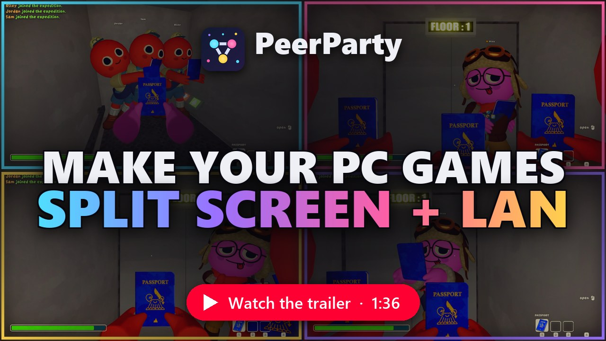
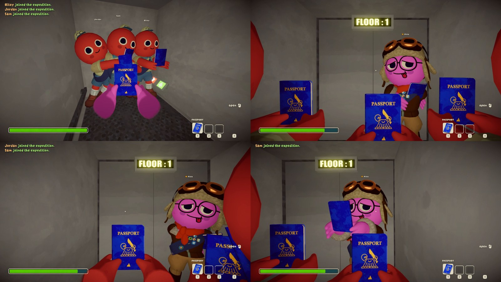
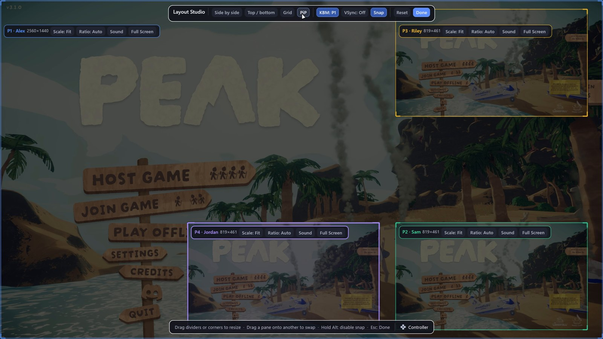
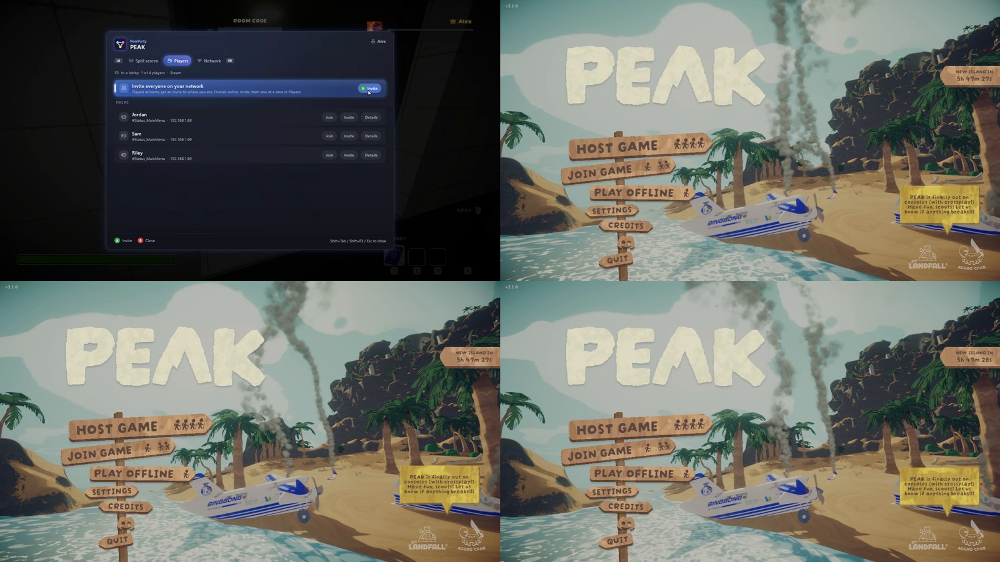
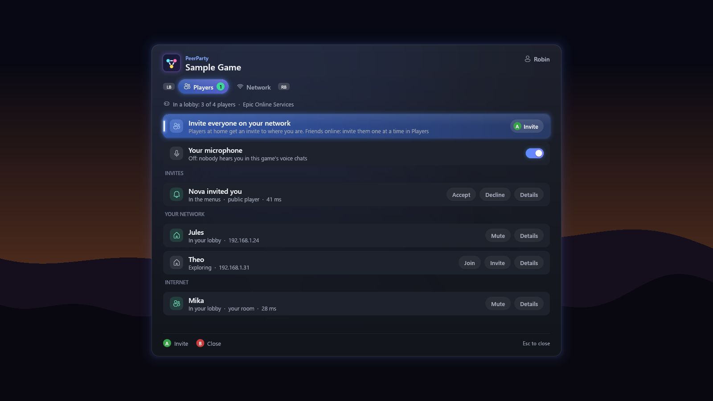
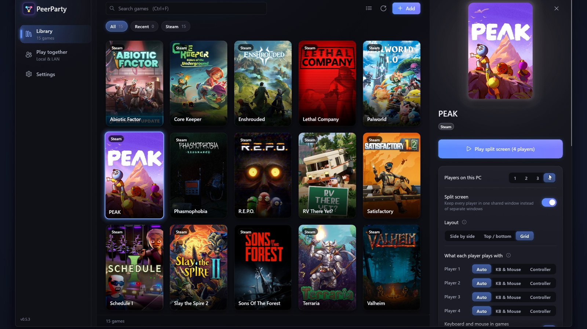

# PeerParty

**Make your PC games split screen + LAN.** PeerParty starts several copies of a game on
one PC in a single split-screen window, each player with their own controller and their
own saves, and lets copies on your network, or friends online, play together. No servers,
no accounts, no internet needed for local play. Free, open source, one portable `.exe`.

<p align="center">
  <a href="https://www.youtube.com/watch?v=EozvfkHUrTE"></a>
</p>

<p align="center">
  <a href="../../releases/latest"><b>Download peerparty.exe</b></a> ·
  <a href="docs/usage.md">How to use it</a> ·
  <a href="https://www.youtube.com/watch?v=EozvfkHUrTE">Watch the trailer</a>
</p>

It works with almost any game whose multiplayer is peer-to-peer: whatever the game uses
(Steamworks, Epic Online Services, PlayFab, GOG Galaxy, Photon, Unity Gaming Services or
Demonware), its lobbies, invites, friends, voice and connections run between the copies
themselves. PeerParty starts the game with a small hook inside it; no game files change.

## 🎮 Split screen on one PC



Pick a game, pick how many players, press **Play**. Every player gets a copy of the game
of their own, and the copies meet in the game's own lobby as if they were on a LAN.

- **One window, drawn on the graphics card.** Each copy's frames go straight into one
  shared window, HDR included. Resize it, or open it on another monitor or the TV.
- **A controller each**, or the keyboard and mouse for one player. Hand controllers
  around, or the keyboard and mouse, while you play.
- **Everyone's own saves.** Player 1 keeps the game's usual saves; the others get their
  own, kept apart. Copy, swap or restore saves between players from the launcher.
- **Joining takes one click.** Host in one pane, press **Invite** in the overlay, and the
  other players are pulled into your lobby.



**Layout Studio** (Ctrl+Alt+E) rearranges the panes while the games run: side by side,
top and bottom, a grid or picture-in-picture, or drag the dividers and corners wherever
you like. Swap two players, set how each game fills its pane, mute a pane. [More on split
screen](#split-screen).

## 🌐 LAN and online, without the servers

<table>
  <tr>
    <td width="50%"></td>
    <td width="50%"></td>
  </tr>
  <tr>
    <td align="center">The overlay in split screen</td>
    <td align="center">Players on your network and online</td>
  </tr>
</table>

- **LAN play for games that only have online play.** PCs on one network find each other's
  games in the game's own lobby browser, invite each other and play, with no internet
  connection at all.
- **Friends online with a room code.** Share a code; your friends show up like LAN
  players. Nothing to forward or host in most homes.
- **Public sessions.** Turn them on and anyone playing the same game through PeerParty
  shows up in the game's own lobby browser or server list.
- **An overlay in every game** (Shift+Tab, Shift+F3 or a controller's Home button):
  who's playing, invites, the network, and split screen's players and controllers.

Split screen and network play mix: two players on the couch can join friends on another
PC, or online, in the same lobby.

## 📚 Your whole library



The launcher finds your Steam, Epic, GOG and Xbox app games, and any game folder you
add. Choose the players on this PC, the layout and what each player plays with, then
**Play**. It works with a mouse, a keyboard or a controller alone, and speaks your
Windows language.

## Keeping multiplayer alive

Online services close. When the lobby, sign-in or matchmaking service a game's
multiplayer was built on shuts down, the multiplayer goes with it, even though the game
itself still runs. PeerParty moves that part onto the players' own PCs:

- **No PeerParty account and no PeerParty servers.** There is no service of ours that
  has to stay up for your games to keep working.
- **LAN play needs only the network**, not even an internet connection.
- **Internet play uses only shared public infrastructure**: the BitTorrent DHT, which no
  single company runs, to find players, and public STUN servers to see through routers.
  Players then connect directly, through an encrypted tunnel.
- **Open source (MIT).** Anyone can build it, fix it and carry it on, whatever happens to
  this project.

## What it covers

| Service | Carried between copies |
|---|---|
| **Steamworks** | Lobbies and their search filters, P2P (ISteamNetworking), networking sockets and messages, friends, rich presence and invites, auth tickets between players, game servers and the server browser. Licence and DLC checks, stats and achievements stay with the Steam client. |
| **Epic Online Services** | Connect and Auth sign-in, user info, friends, lobbies, sessions, presence, P2P, custom invites and request to join, voice (RTC rooms and lobby voice). |
| **PlayFab** | Party (networks, endpoints, voice and text chat), Lobby & Matchmaking, sign-in through the C SDK, and the web API (sign-in, lobbies, statistics, user data, friends). |
| **GOG Galaxy** | Sign-in, user data, friends, rich presence, invites, lobbies, P2P, chat, stats and achievements, storage and cloud saves (every SDK from 1.57 on). |
| **Photon** | Realtime / PUN rooms served by one of the players' copies (name, master and game servers over UDP, TCP and WebSocket), Photon Voice, Chat, Bolt, and Fusion's Host, Server, Client and Shared modes. |
| **Unity Gaming Services** | Authentication, Lobby (with Wire events), Relay (plain and DTLS), Cloud Save and Remote Config; Vivox voice chat, positional (proximity) channels included. |
| **Demonware** | Sign-in, the lobby service's server time and matchmaking (sessions hosted, updated, searched for and found by player), and Demonware's own address check, alongside the game's Steam lobbies and invites. |
| **Xbox app games** | Started as packages with PeerParty inside; PlayFab Party's Xbox Live helper and the Xbox Live friends and presence calls are answered by PeerParty. |

Anything PeerParty doesn't carry behaves as if that service were offline or had nothing
in it, so the game carries on without it. [docs/design.md](docs/design.md) lists exactly
what is covered and what can't be.

## What to know first

- **Play with copies of games you're licensed to run**, on every PC. PeerParty replaces
  the multiplayer services, sign-in included, which it answers locally. Licence, DLC and
  purchase checks reach the store's own SDK, or come back empty or offline.
  You're responsible for the copies you run and the terms that come with them. See
  [LEGAL.md](LEGAL.md).
- **No anti-cheat games.** PeerParty stops a game in which EasyAntiCheat or BattlEye
  loads, or that starts an EOS Anti-Cheat session while PeerParty's EOS layer is on.
- **Windows 10 or 11**, for 64-bit and 32-bit games.
- **Games whose multiplayer runs on the publisher's own servers** (server-side game code,
  hosted dedicated servers) can't be played this way by any tool.

## FAQ

### How do I know my game will work?

Running several copies of a game side by side in split screen works with most games, as
long as your PC can handle that many copies at once.

For those copies, or PCs on your network, or friends online, to **play together**, the
game's multiplayer has to be **peer-to-peer**: one player hosts, the others join them,
and no game server of the publisher's runs the match. A quick web search such as *"Does
&lt;game&gt; use peer-to-peer multiplayer, and which service does it use?"* often turns up
the answer. A **Host game** / **Join game** menu and invites through Steam or Epic are good
signs.

PeerParty carries these services today, and more can be added:

- **Steamworks**: lobbies, P2P networking, invites, game servers and the server browser
- **Epic Online Services**: lobbies, sessions, P2P, invites, voice
- **PlayFab**: Party, Lobby and Matchmaking
- **GOG Galaxy**: lobbies, P2P, invites
- **Photon**: Realtime / PUN, Bolt, Fusion, Voice and Chat
- **Unity Gaming Services**: Lobby, Relay and Vivox voice
- **Demonware**: sign-in and matchmaking
- **Xbox app games**: PlayFab Party's Xbox Live helper, friends and presence

[What it covers](#what-it-covers) has the details. Games whose matches run on the
publisher's own servers, and games with anti-cheat (EasyAntiCheat, BattlEye), can't be
played this way.

### My game isn't working!

Let's fix that. Every game you start through PeerParty writes a log of what PeerParty did
in it. To find it, open the launcher's **Settings** and press **Open logs**, or paste
`%TEMP%\peerparty\logs` into File Explorer's address bar. There is one file per run,
named after the game's exe and the time it started (for example
`game-20261109-183005-4242.log`); the newest one for the game is the one you want.

If it's a peer-to-peer game, please [open an issue](../../issues) saying which game and
store it was, what you tried and what happened, and attach that log.
[docs/testing.md](docs/testing.md) says which lines in it show what each layer did.

### Do I need a copy of the game for every player?

Play with copies you're licensed to run: PeerParty replaces a game's multiplayer
services, not the store. Licence, DLC and purchase checks still go to the store's own
SDK. See [LEGAL.md](LEGAL.md).

### Does it change my game?

No. PeerParty hooks the game in memory while it runs; the game's files are never
changed. Its own settings and data live in `%LOCALAPPDATA%\peerparty`, and
[LEGAL.md](LEGAL.md) lists everything it writes anywhere else.

### Is it free?

Yes: free and open source (MIT), with no account, no subscription and no servers of
ours. One portable `.exe`, nothing to install.

## Download and run

Download `peerparty.exe` from the [Releases](../../releases) page; there is nothing to
install. It isn't code-signed, so Windows can't tell you who made it: before you run it,
check it is the file the release names. Each release's notes end with its SHA-256; in
PowerShell, `Get-FileHash .\peerparty.exe` must print the same. Only then, if Windows
SmartScreen says "Windows protected your PC" the first time, choose **More info**, then
**Run anyway**. A file from anywhere else, or one whose hash differs, isn't PeerParty's.

Double-click it for the launcher window. It lists your Steam, Epic, GOG and Xbox app
games and any game folders you add; pick one and press **Play** (or A on a controller).
The first run asks how you play (split screen on this PC, people on your network,
friends with a room code, anyone in public sessions); **Play together** changes it later. The window and the
overlay speak your Windows language, and work with a mouse, a keyboard or a controller
alone. Games started through PeerParty find each other: copies on other PCs on your
network, and in your room or public sessions if you use them. A game's panel can start
up to four players on one PC in a split-screen window (or two in separate windows), copy
the first player's saves for the others, and turn single layers off.

Updates: once a day the window asks GitHub whether a newer PeerParty is out (Settings >
About, where it can be turned off). **Download** opens it in your browser; PeerParty
checks the file has the SHA-256 GitHub publishes for the release before it replaces
itself, and never while a game runs. A copy that came with another app's add-on is updated through that add-on.

Windows Firewall may ask to let the game accept connections the first time: allow it on
private networks. If it's blocked (a cancelled prompt leaves a Block rule), the game's
panel, the sidebar and the overlay's Players and Network pages say so, and **Fix** lets it
through (Windows asks for permission).

## Internet play

**Public sessions** are the quickest way: nothing to share or set up. Turn them on in
Play together > Anyone online > **Public sessions** (the first run offers it too), or
for one run with `peerparty --public game.exe`, then start the game. Anyone online
playing the same game through PeerParty shows up in the game's own lobby browser or
server list, and your lobbies show up in theirs.

They're off until you turn them on, because strangers can then see and join your games:

- Every player has a signed key, and you can block one from the overlay. Invites from
  public players always wait for you to accept them, and voice chat with them can be
  turned off in Play together.
- PeerParty never shows addresses, but peers you connect to see yours at the network
  level, as in any peer-to-peer game, and while public sessions are on it is listed on
  the public BitTorrent DHT.

Details: [docs/public-sessions.md](docs/public-sessions.md).

**Room codes** keep it to your friends:

1. One player makes a room code: Play together > Friends online > **Make a room**, or
   `peerparty --new-room`.
2. Send it to your friends privately; everyone else pastes it into Play together >
   Friends online > **Join with a code**.
3. Start the game as usual. Within about a minute the others show up like LAN players.

Anyone with the code is trusted like a LAN player, so share it only with friends. Room
codes, public sessions and LAN play work at the same time. Details:
[docs/internet-dht.md](docs/internet-dht.md).

Both connect PCs directly. PeerParty asks the router to forward its port (UPnP, NAT-PMP
or PCP) and uses IPv6 when both PCs have it. There is no relay: if both homes are behind
strict ("symmetric") NATs, one player forwards a UDP port. `peerparty --net-test` checks
your connection.

To play on your local network only for a while, switch **Internet play** off on the
overlay's Network page (or in Play together, or `--set internet=off`). It takes effect at
once and keeps your settings: players on your local network stay connected, room and
public players leave until you switch it back on.

## The overlay

Shift+Tab, Shift+F3 or a controller's Home / Guide button opens an overlay over the game:
the game's players on this PC, your LAN, in your room and in public sessions, each listed
once, your lobby, invites waiting for you, and the internet play switch; in split screen,
a tab for this PC's players and their controllers. How it looks and opens is set in the
launcher, and applies to a running game at once. The game's own "invite friends"
buttons open it too. While it shows, the game gets no keyboard, mouse or controller
input. When Xbox Game Bar opens over the game,
the overlay stays open underneath and leaves the input to Game Bar until it closes.

## Split screen

A game's panel (Players: 2–4, **Split screen**) or `--split-screen` starts up to four
copies of the game in one window, one pane per player:

- **One window, drawn on the graphics card.** Each copy's frames go straight to the
  session's window through shared GPU textures, HDR included; a copy whose frames can't
  be shared that way shows its own window in its pane.
- **Layout Studio** (Ctrl+Alt+E, or the overlay's Split screen tab > **Arrange panes**):
  drag the dividers and corners while the games run, swap two players, pick how each
  game fills its pane and the aspect ratio it renders at, mute a pane's sound. **Done**
  keeps the layout for the game. Ctrl+Alt+L switches layout, Ctrl+Alt+Z zooms a pane onto
  the whole window, Ctrl+Alt+1–4 hands the keyboard and mouse to a pane.
- **Each player their own saves.** Player 1 plays with the game's own saves, the same
  ones they have when playing alone; players 2–4 each have their own in PeerParty's
  folder. The game's files are never changed.
- **Controllers only**, if you like (`--no-kbm`, or "Keyboard and mouse in games" off):
  bumping the mouse or keyboard then never reaches the games.
- **Copies start one after another**: each once the one before has its window or first
  frame up, so heavy games don't fight over the disk at startup (`--stagger`).
- **Sync games to screen** (on unless `--no-sync`): no copy draws frames faster than
  the window shows them.

What it does for now: Windows only; one keyboard and mouse plus controllers, for up to
four players. Racing wheels and a keyboard and mouse per player are planned.
[docs/usage.md](docs/usage.md#split-screen) has every option and key.

## Command line and Steam launch options

`peerparty [options] <game.exe> [game's own arguments]` starts a game through PeerParty.
To start a Steam game through PeerParty from the Steam client, set its launch options
(the game's Properties > General > Launch options) to the path of `peerparty.exe`
followed by `%command%`; Steam puts the game's own command line there:

```
peerparty "C:\Games\Some Game\game.exe"
"C:\Tools\peerparty.exe" %command%
"C:\Tools\peerparty.exe" --public %command%
```

Settings made in the launcher window apply however the game is started, a launch option
included. Options for one run go in front of the game's path (or of `%command%`):

| Option | What it does |
|---|---|
| `--room CODE` | Plays in that room this run (`--room off`: no room). |
| `--public` | Turns public sessions on this run. |
| `--set key=value` | Changes one setting this run, e.g. `name=Alex`, `voice=off`, `internet=off`. |
| `--multi-instance` | Lets a second copy of the game start on the same PC. |
| `--split-screen` | Starts 2–4 copies (`--instances N`, default 2) in one shared split-screen window (`--layout horizontal\|vertical\|top2\|bottom2\|grid\|slots:...`), each player on a controller or the keyboard and mouse (`--inputs auto\|kbm\|pad,...`), with names of their own (`--names A,B,...`). |
| `--monitor N` | With `--split-screen`: the monitor the session's window opens on (1 the main one, 2.. the others, left to right). |
| `--no-kbm` | With `--split-screen`: controllers only; the keyboard and mouse never reach the games. |
| `--stagger smart\|0..60` | With `--split-screen`: start each copy once the one before is ready (`smart`, the default), or that many seconds apart (`0`: all at once). |
| `--no-sync` | With `--split-screen`: turns off "Sync games to screen", which keeps each copy from drawing faster than the window shows its frames. |
| `--player N` | Plays alone as player N (1–4): that player's saves, name and identity. |
| `--copy-saves` | Later players start from a copy of player 1's saves; what they had is kept as a backup. Only when given. |
| `--log-dir DIR` | Where the logs go. |

Commands on their own:

| Command | What it does |
|---|---|
| `peerparty --new-room` | Makes a room code. |
| `peerparty --net-test` | Checks this PC's path to the internet for internet play. |
| `peerparty --invite` | The game in front invites every other player (bind it to a hotkey). |
| `peerparty --saves <game.exe>` | Each player's saves for the game, and their backups. |
| `peerparty --copy-save FROM TO <game.exe>` | Copies one player's saves to another (players 1–4); `--swap-saves A B`, `--reset-save N` and `--restore-save N BACKUP` too. What's replaced is backed up first. |
| `peerparty --firewall game.exe` | Says whether Windows Firewall lets other players connect to the game; `--fix-firewall game.exe` (as administrator) lets them. |
| `peerparty --blocked`, `--block FINGERPRINT`, `--unblock FINGERPRINT` | The public players you blocked. |
| `peerparty --pads` | Lists the controllers the overlay reads. |

`peerparty --help` prints them all. Every option, setting and environment variable is
in [docs/usage.md](docs/usage.md).

## Build from source

On Windows with rustup and the MSVC build tools: `rust-toolchain.toml` names the Rust
version PeerParty is tested with, and rustup fetches it (with the 32-bit target for
32-bit games' hook) the first time you build:

```
cargo build --release
```

`target\release\peerparty.exe` is the whole program: the build compiles the hook DLL for
both architectures and embeds them. `cargo test --workspace` runs the unit and loopback
tests; `tests\run_all.ps1` adds Photon's .NET client and the two-copy SDK tests, which
use SDK DLLs copied from games you have installed ([docs/testing.md](docs/testing.md)).
[AGENTS.md](AGENTS.md) has notes for contributors.

## Docs

- [docs/usage.md](docs/usage.md): the launcher, the command line, settings and
  environment variables, each SDK layer in detail, the overlay.
- [docs/design.md](docs/design.md): the architecture, the per-SDK front ends, the shared
  LAN core, coverage, gaps and sources.
- [docs/internet-dht.md](docs/internet-dht.md): internet play over the DHT.
- [docs/public-sessions.md](docs/public-sessions.md): public sessions and how addresses
  stay hidden.
- [docs/testing.md](docs/testing.md): the automated tests, and how to report a game.
- [LEGAL.md](LEGAL.md): what PeerParty doesn't do, what it changes on your PC,
  trademarks.

## License

MIT, see [LICENSE](LICENSE). retour in `vendor\retour` is BSD-2-Clause (the published
crate, with local fixes). The Photon servers in `hook\src\photon` are ported from Luxon and
Luxon Server, BSD-3-Clause (`hook\src\photon\LICENSE-Luxon`).

PeerParty is an independent project. It is not affiliated with, endorsed by or sponsored
by Valve, Epic Games, Microsoft, GOG, Exit Games, Unity Technologies or any game
publisher. Product names are used only to say what PeerParty works with; see
[LEGAL.md](LEGAL.md) for the trademarks.
