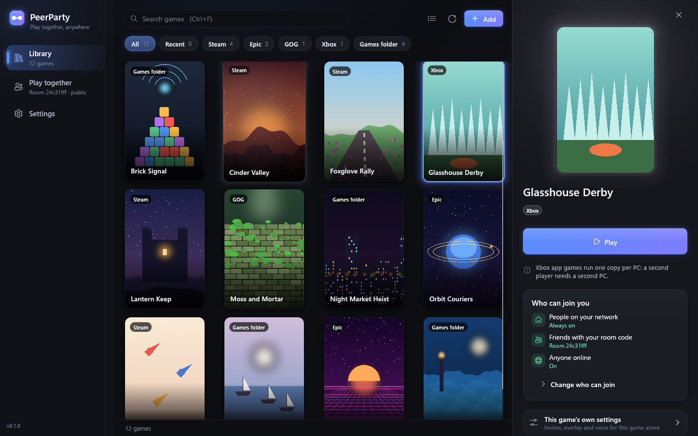
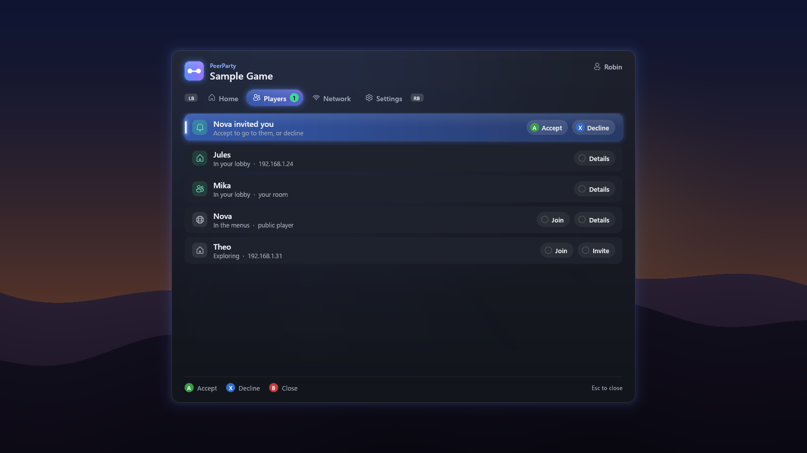

# PeerParty

**PeerParty** lets PC games play together over the LAN, or over the internet with
friends or anyone playing the same game, without the online services their multiplayer
was built on. Whatever a game uses (Steamworks, Epic Online Services, PlayFab, GOG
Galaxy, Photon or Unity Gaming Services), its lobbies, invites, friends, voice and
connections run between the copies themselves. It's one Windows program, written in
Rust, that starts the game with a small hook inside it. No game files change.

<table>
  <tr>
    <td></td>
    <td></td>
  </tr>
  <tr>
    <td align="center">Launcher</td>
    <td align="center">In-game overlay</td>
  </tr>
</table>

## Keeping multiplayer alive

Online services close. When the lobby, sign-in or matchmaking service a game's
multiplayer was built on shuts down, the multiplayer goes with it, even though the game
itself still runs. PeerParty moves that part onto the players' own PCs:

- **No PeerParty account and no PeerParty servers.** There is no service of ours that
  has to stay up for your games to keep working.
- **LAN play needs only the network**, not even an internet connection.
- **Internet play uses only shared public infrastructure**: the BitTorrent DHT, which no
  single company runs, to find players, and public STUN servers to see through routers.
  Players then connect directly.
- **Open source (MIT).** Anyone can build it, fix it and carry it on, whatever happens to
  this project.

## Why use it

- **LAN play for games that only have online play.** Two or more PCs on one network find
  each other's games in the game's own lobby browser, invite each other and play, with
  no internet connection and no PeerParty account.
- **Internet play with no server and no setup.** Turn on public sessions and anyone
  playing the same game through PeerParty shows up in the game's own lobby browser or
  server list, like a LAN player. To play with friends only, share a private room code
  instead. Either way, players find each other through the public BitTorrent DHT and
  connect directly, through an encrypted tunnel.
- **Several copies on one PC.** Two players on one PC each get their own instance, with
  their own identity, and they meet as LAN players do.
- **An overlay in every game**: players, invites and settings, opened with the usual
  store hotkeys or a controller's Home button.

## What it covers

| Service | Carried between copies |
|---|---|
| **Steamworks** | Lobbies and their search filters, P2P (ISteamNetworking), networking sockets and messages, friends, rich presence and invites, auth tickets between players, game servers and the server browser. Licence and DLC checks, stats and achievements stay with the Steam client. |
| **Epic Online Services** | Connect and Auth sign-in, user info, friends, lobbies, sessions, presence, P2P, custom invites and request to join, voice (RTC rooms and lobby voice). |
| **PlayFab** | Party (networks, endpoints, voice and text chat), Lobby & Matchmaking, sign-in through the C SDK, and the web API (sign-in, lobbies, statistics, user data, friends). |
| **GOG Galaxy** | Sign-in, user data, friends, rich presence, invites, lobbies, P2P, chat, stats and achievements, storage and cloud saves (every SDK from 1.57 on). |
| **Photon** | Realtime / PUN rooms served by one of the players' copies (name, master and game servers over UDP, TCP and WebSocket), Photon Voice, Chat, Bolt, and Fusion's Host, Server, Client and Shared modes. |
| **Unity Gaming Services** | Authentication, Lobby (with Wire events), Relay (plain and DTLS), Cloud Save and Remote Config. |
| **Xbox app games** | Started as packages with PeerParty inside; PlayFab Party's Xbox Live helper and the Xbox Live friends and presence calls are answered by PeerParty. |

Anything PeerParty doesn't carry behaves as if that service were offline or had nothing
in it, so the game carries on without it. [docs/design.md](docs/design.md) lists exactly
what is covered and what can't be.

## What to know first

- **Play with copies of games you're licensed to run**, on every PC. PeerParty replaces
  the multiplayer services, sign-in included, which it answers locally. Licence, DLC and
  purchase checks reach the store's own SDK, or come back empty or offline.
  You're responsible for the copies you run and the terms that come with them. See
  [LEGAL.md](LEGAL.md).
- **No anti-cheat games.** PeerParty stops a game in which EasyAntiCheat or BattlEye
  loads, or that starts an EOS Anti-Cheat session while PeerParty's EOS layer is on.
- **Windows 10 or 11**, for 64-bit and 32-bit games.
- **Games whose multiplayer runs on the publisher's own servers** (server-side game code,
  hosted dedicated servers) can't be played this way by any tool.

## Download and run

Download `peerparty.exe` from the [Releases](../../releases) page; there is nothing to
install. It isn't code-signed, so Windows SmartScreen may say "Windows protected your PC"
the first time: choose **More info**, then **Run anyway**.

Double-click it for the launcher window. It lists your Steam, Epic, GOG and Xbox app
games and any game folders you add; pick one and press **Play** (or A on a controller).
The first run asks who you play with (people on your network, friends with a room code,
anyone in public sessions); **Play together** changes it later. The window and the
overlay speak your Windows language, and work with a mouse, a keyboard or a controller
alone. Games started through PeerParty find each other: copies on other PCs on your
network, and in your room or public sessions if you use them. A game's panel can start
two instances on one PC, copy the first player's saves for the second, and turn single
layers off.

Windows Firewall may ask to let the game accept connections the first time: allow it on
private networks. If it's blocked (a cancelled prompt leaves a Block rule), the game's
panel, the sidebar and the overlay's Home and Network pages say so, and **Fix** lets it
through (Windows asks for permission).

## Internet play

**Public sessions** are the quickest way: nothing to share or set up. Turn them on in
Play together > Anyone online > **Public sessions** (the first run offers it too), or
for one run with `peerparty --public game.exe`, then start the game. Anyone online
playing the same game through PeerParty shows up in the game's own lobby browser or
server list, and your lobbies show up in theirs.

They're off until you turn them on, because strangers can then see and join your games:

- Every player has a signed key, and you can block one from the overlay. Invites from
  public players always wait for you to accept them, and voice chat with them can be
  turned off in Play together.
- PeerParty never shows addresses, but peers you connect to see yours at the network
  level, as in any peer-to-peer game, and while public sessions are on it is listed on
  the public BitTorrent DHT.

Details: [docs/public-sessions.md](docs/public-sessions.md).

**Room codes** keep it to your friends:

1. One player makes a room code: Play together > Friends online > **Make a room**, or
   `peerparty --new-room`.
2. Send it to your friends privately; everyone else pastes it into Play together >
   Friends online > **Join with a code**.
3. Start the game as usual. Within about a minute the others show up like LAN players.

Anyone with the code is trusted like a LAN player, so share it only with friends. Room
codes, public sessions and LAN play work at the same time. Details:
[docs/internet-dht.md](docs/internet-dht.md).

Both connect PCs directly. PeerParty asks the router to forward its port (UPnP, NAT-PMP
or PCP) and uses IPv6 when both PCs have it. There is no relay: if both homes are behind
strict ("symmetric") NATs, one player forwards a UDP port. `peerparty --net-test` checks
your connection.

To play on your local network only for a while, switch **Internet play** off on the
overlay's Network page (or in Play together, or `--set internet=off`). It takes effect at
once and keeps your settings: players on your local network stay connected, room and
public players leave until you switch it back on.

## The overlay

Shift+Tab, Shift+F3 or a controller's Home / Guide button opens an overlay over the game:
the game's players on your LAN, in your room and in public sessions, your lobby, invites
waiting for you, the internet play switch and settings. The game's own "invite friends"
buttons open it too. While it shows, the game gets no keyboard, mouse or controller
input. When Xbox Game Bar opens over the game,
the overlay stays open underneath and leaves the input to Game Bar until it closes.

## Command line and Steam launch options

`peerparty [options] <game.exe> [game's own arguments]` starts a game through PeerParty.
To start a Steam game through PeerParty from the Steam client, set its launch options
(the game's Properties > General > Launch options) to the path of `peerparty.exe`
followed by `%command%`; Steam puts the game's own command line there:

```
peerparty "C:\Games\Some Game\game.exe"
"C:\Tools\peerparty.exe" %command%
"C:\Tools\peerparty.exe" --public %command%
```

Settings made in the launcher window apply however the game is started, a launch option
included. Options for one run go in front of the game's path (or of `%command%`):

| Option | What it does |
|---|---|
| `--room CODE` | Plays in that room this run (`--room off`: no room). |
| `--public` | Turns public sessions on this run. |
| `--set key=value` | Changes one setting this run, e.g. `name=Alex`, `voice=off`, `internet=off`. |
| `--multi-instance` | Lets a second copy of the game start on the same PC. |
| `--copy-saves` | A second copy on the same PC starts from the first copy's saves. |
| `--appid N` | A Steam game's app id, when PeerParty can't find it. |
| `--log-dir DIR` | Where the logs go. |

Commands on their own:

| Command | What it does |
|---|---|
| `peerparty --new-room` | Makes a room code. |
| `peerparty --net-test` | Checks this PC's path to the internet for internet play. |
| `peerparty --invite` | The game in front invites every other player (bind it to a hotkey). |
| `peerparty --firewall game.exe` | Says whether Windows Firewall lets other players connect to the game; `--fix-firewall game.exe` (as administrator) lets them. |
| `peerparty --blocked`, `--block FINGERPRINT`, `--unblock FINGERPRINT` | The public players you blocked. |
| `peerparty --pads` | Lists the controllers the overlay reads. |

`peerparty --help` prints them all. Every option, setting and environment variable is
in [docs/usage.md](docs/usage.md).

## If a game doesn't work

Every game you start through PeerParty writes a log of what PeerParty did in it. To find
it, open the launcher's **Settings** and press **Open logs**, or paste
`%TEMP%\peerparty\logs` into File Explorer's address bar. There is one file per run,
named after the game's exe and the time it started (for example
`game-20261109-183005-4242.log`); the newest one for the game is the one you want.

Please [open an issue](../../issues) saying which game and store it was, what you tried
and what happened, and attach that log. [docs/testing.md](docs/testing.md) says which
lines in it show what each layer did.

## Build from source

On Windows with the Rust toolchain (MSVC) and the 32-bit target for 32-bit games' hook:

```
rustup target add i686-pc-windows-msvc
cargo build --release
```

`target\release\peerparty.exe` is the whole program: the build compiles the hook DLL for
both architectures and embeds them. `cargo test --workspace` runs the unit and loopback
tests; `tests\run_all.ps1` adds Photon's .NET client and the two-copy SDK tests, which
use SDK DLLs copied from games you have installed ([docs/testing.md](docs/testing.md)).
[AGENTS.md](AGENTS.md) has notes for contributors.

## Docs

- [docs/usage.md](docs/usage.md): the launcher, the command line, settings and
  environment variables, each SDK layer in detail, the overlay.
- [docs/design.md](docs/design.md): the architecture, the per-SDK front ends, the shared
  LAN core, coverage, gaps and sources.
- [docs/internet-dht.md](docs/internet-dht.md): internet play over the DHT.
- [docs/public-sessions.md](docs/public-sessions.md): public sessions and how addresses
  stay hidden.
- [docs/testing.md](docs/testing.md): the automated tests, and how to report a game.
- [LEGAL.md](LEGAL.md): what PeerParty doesn't do, what it changes on your PC,
  trademarks.

## License

MIT, see [LICENSE](LICENSE). retour in `vendor\retour` is BSD-2-Clause (the published
crate, with local fixes). The Photon servers in `hook\src\photon` are ported from Luxon and
Luxon Server, BSD-3-Clause (`hook\src\photon\LICENSE-Luxon`).

PeerParty is an independent project. It is not affiliated with, endorsed by or sponsored
by Valve, Epic Games, Microsoft, GOG, Exit Games, Unity Technologies or any game
publisher. Product names are used only to say what PeerParty works with; see
[LEGAL.md](LEGAL.md) for the trademarks.
